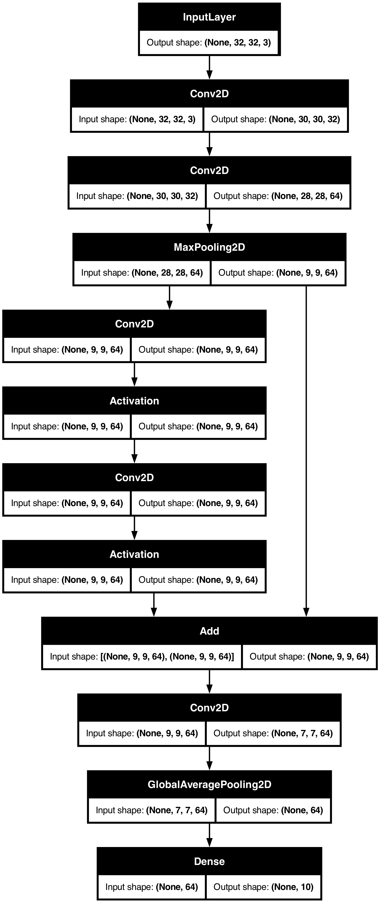

# 🧠 Mini-ResNet für CIFAR-10

Ein kleines **Convolutional Neural Network mit einer Residual-Verbindung**
(Skip-Connection), gebaut mit der **Keras Functional API** und trainiert auf
dem Bilddatensatz **CIFAR-10**.

Das Projekt zeigt in rund 70 Zeilen den kompletten Weg vom Datensatz über die
Modellarchitektur bis zum Training – und läuft wahlweise lokal (mit
GPU-Beschleunigung über Metal auf Apple Silicon) oder im Docker-Container.

---

## 📦 Der Datensatz: CIFAR-10

- 60.000 Farbbilder (50.000 Training, 10.000 Test)
- Auflösung **32 × 32 Pixel**, 3 Farbkanäle (RGB)
- **10 Klassen:** Flugzeug, Auto, Vogel, Katze, Hirsch, Hund, Frosch, Pferd,
  Schiff, LKW

Die Pixelwerte werden von `0–255` auf `0–1` skaliert, damit das Training
stabiler läuft. Die Labels bleiben ganze Zahlen (`0–9`).

---

## 🏗️ Die Architektur

Das folgende Diagramm erzeugt das Skript selbst mit `utils.plot_model(...)`.
Jeder Block zeigt eine Schicht mit Eingabe- und Ausgabeform
(`None` steht für die noch unbekannte Batch-Größe):

<p align="center">
  
</p>

Das Netz besteht aus drei Teilen:

| Teil | Schichten | Was passiert? | Form danach |
|------|-----------|---------------|-------------|
| **Stem** | 2× `Conv2D` (32 / 64 Filter), `MaxPooling2D(3)` | Einfache Merkmale wie Kanten und Farbflächen erkennen, Feature-Map verkleinern | `9 × 9 × 64` |
| **Residual-Block** | 2× `Conv2D` (64 Filter, `padding="same"`) + `Activation("relu")`, dann `Add` | Komplexere Merkmale lernen; der Eingang wird über die Skip-Connection wieder aufaddiert | `9 × 9 × 64` |
| **Head** | `Conv2D`, `GlobalAveragePooling2D`, `Dense(10, softmax)` | Jede Feature-Map auf einen Wert mitteln und in Wahrscheinlichkeiten für die 10 Klassen umrechnen | `10` |

Insgesamt hat das Modell nur rund **131.000 trainierbare Parameter**.

### 🔀 Warum die Skip-Connection?

Im Diagramm sieht man rechts den Pfeil, der vom `MaxPooling2D` direkt zum
`Add`-Block führt – an den beiden Convolutions vorbei. Das ist die Idee hinter
**ResNet** (*Residual Network*):

```
Ausgabe = F(x) + x
```

Der Block muss nicht die komplette Transformation lernen, sondern nur die
*Differenz* (das Residuum) zur Eingabe. Außerdem kann der Gradient beim
Training über die Abkürzung ungehindert zurückfließen. Dadurch lassen sich
auch sehr tiefe Netze gut trainieren.

Damit `Add` funktioniert, müssen beide Tensoren **exakt dieselbe Form** haben.
Deshalb verwenden die Convolutions im Block `padding="same"` und 64 Filter –
so bleibt die Form bei `9 × 9 × 64`.

---

## 🏋️ Training

```python
model.compile(
    optimizer="adam",
    loss="sparse_categorical_crossentropy",  # Labels sind Integer, nicht One-Hot
    metrics=["accuracy"],
)
model.fit(x_train, y_train, epochs=10, validation_data=(x_test, y_test))
```

Nach dem Training plottet das Skript mit `matplotlib` die **Trainings- und
Validierungs-Genauigkeit** pro Epoche. Liegt die Trainings-Kurve deutlich über
der Validierungs-Kurve, ist das ein Zeichen für *Overfitting*.

---

## 🚀 Ausführen

### Lokal

Voraussetzung: **Python 3.10–3.12** (TensorFlow 2.18 unterstützt kein 3.13)
und **Graphviz** für das Architektur-Diagramm.

```bash
brew install graphviz          # macOS; unter Linux: apt install graphviz

python3.12 -m venv venv
source venv/bin/activate
pip install -r requirements.txt

python neural_net.py
```

Auf Macs mit Apple Silicon wird über `tensorflow-metal` automatisch die GPU
genutzt.

### Mit Docker

```bash
docker build -t neural-net .
docker run --rm \
  -v "$PWD/output:/app/output" \
  -v keras-cache:/root/.keras \
  neural-net
```

- Das Architektur-Diagramm landet in `./output/mini_resnet.png`.
- Das Volume `keras-cache` speichert den heruntergeladenen Datensatz, damit er
  nicht bei jedem Start neu geladen wird.
- ⚠️ Docker-Container haben auf dem Mac **keinen Zugriff auf die Metal-GPU** –
  das Training läuft dort auf der CPU und ist entsprechend langsamer.
- Im Container gibt es kein Display, `plt.show()` zeigt den Accuracy-Plot
  daher nicht an.

---

## 📁 Dateien

| Datei | Inhalt |
|-------|--------|
| [`neural_net.py`](neural_net.py) | Daten laden, Modell bauen, Diagramm speichern, trainieren, plotten |
| [`mini_resnet.png`](mini_resnet.png) | Von `plot_model` erzeugtes Architektur-Diagramm |
| [`pyproject.toml`](pyproject.toml) | Abhängigkeiten (plattformübergreifend, wird im Docker-Image genutzt) |
| [`requirements.txt`](requirements.txt) | Exakt gepinnte Versionen für die lokale Mac-Umgebung (inkl. `tensorflow-metal`) |
| [`Dockerfile`](Dockerfile) | Container-Image auf Basis von `python:3.12-slim` mit `uv` und Graphviz |

---

## 💡 Ideen zum Weiterbauen

- Den Accuracy-Plot mit `plt.savefig("accuracy.png")` als Bild speichern
- Einen zweiten Residual-Block hinzufügen und vergleichen, ob die Genauigkeit
  steigt
- `BatchNormalization` nach den Convolutions einbauen (wie im echten ResNet)
- **Data Augmentation** (`RandomFlip`, `RandomCrop`) gegen Overfitting
- Das trainierte Modell mit `model.save("mini_resnet.keras")` speichern und
  auf eigenen Bildern testen
